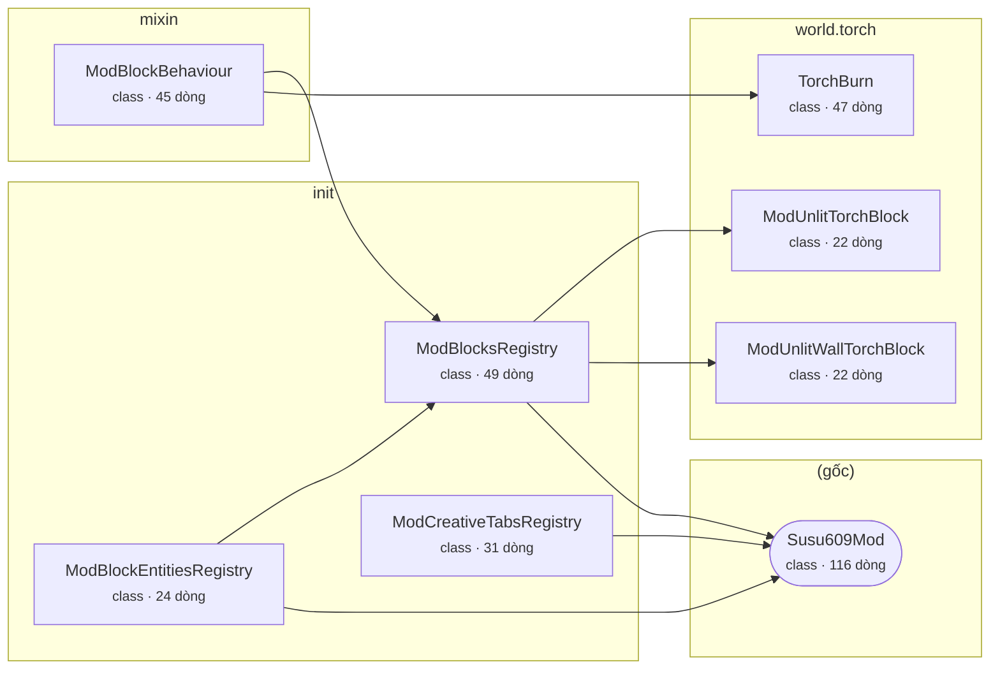

# Kiến trúc mã

> File này được sinh tự động bởi `tools/gen_architecture.py`. Đừng sửa tay.

- Package gốc: `net.susu609.the8dungeon`
- 8 class/kiểu Java, 356 dòng, 8 phụ thuộc nội bộ

Mũi tên `A --> B` nghĩa là A có dùng tới B. Khối bo tròn là entry point `@Mod`.

## Class theo package

### (gốc)

| Class | Loại | Dòng | Dùng tới | Event Forge |
|---|---|---|---|---|
| `Susu609Mod` | class | 116 | - | NetworkEvent, NetworkEvent.Context, TickEvent, TickEvent.Phase, TickEvent.ServerTickEvent |

### init

| Class | Loại | Dòng | Dùng tới | Event Forge |
|---|---|---|---|---|
| `ModBlockEntitiesRegistry` | class | 24 | ModBlocksRegistry, Susu609Mod | - |
| `ModBlocksRegistry` | class | 49 | ModUnlitTorchBlock, ModUnlitWallTorchBlock, Susu609Mod | - |
| `ModCreativeTabsRegistry` | class | 31 | Susu609Mod | - |

### mixin

| Class | Loại | Dòng | Dùng tới | Event Forge |
|---|---|---|---|---|
| `ModBlockBehaviour` | class | 45 | ModBlocksRegistry, TorchBurn | - |

### world.torch

| Class | Loại | Dòng | Dùng tới | Event Forge |
|---|---|---|---|---|
| `ModUnlitTorchBlock` | class | 22 | - | - |
| `ModUnlitWallTorchBlock` | class | 22 | - | - |
| `TorchBurn` | class | 47 | - | - |

## Tài nguyên

- `META-INF/mods.toml`
- `assets/susu609/blockstates/torch_off.json`
- `assets/susu609/blockstates/wall_torch_off.json`
- `assets/susu609/lang/en_us.json`
- `assets/susu609/lang/vi_vn.json`
- `assets/susu609/models/block/torch_off.json`
- `assets/susu609/models/block/wall_torch_off.json`
- `assets/susu609/models/item/clawd_spawn_egg.json`
- `assets/susu609/models/item/torch.json`
- `assets/susu609/models/item/torch_off.json`
- `assets/susu609/sounds.json`
- `assets/susu609/textures/entity/clawd_agent.png`
- `assets/susu609/textures/gui/title/mod_title.png`
- `assets/susu609/textures/map/minimap_icons.png`
- `data/susu609/loot_tables/blocks/torch_dim.json`
- `data/susu609/loot_tables/blocks/torch_off.json`
- `data/susu609/loot_tables/blocks/wall_torch_dim.json`
- `data/susu609/loot_tables/blocks/wall_torch_off.json`
- `data/susu609/worldgen/world_preset/void.json`
- `pack.mcmeta`
- `susu609.mixins.json`
