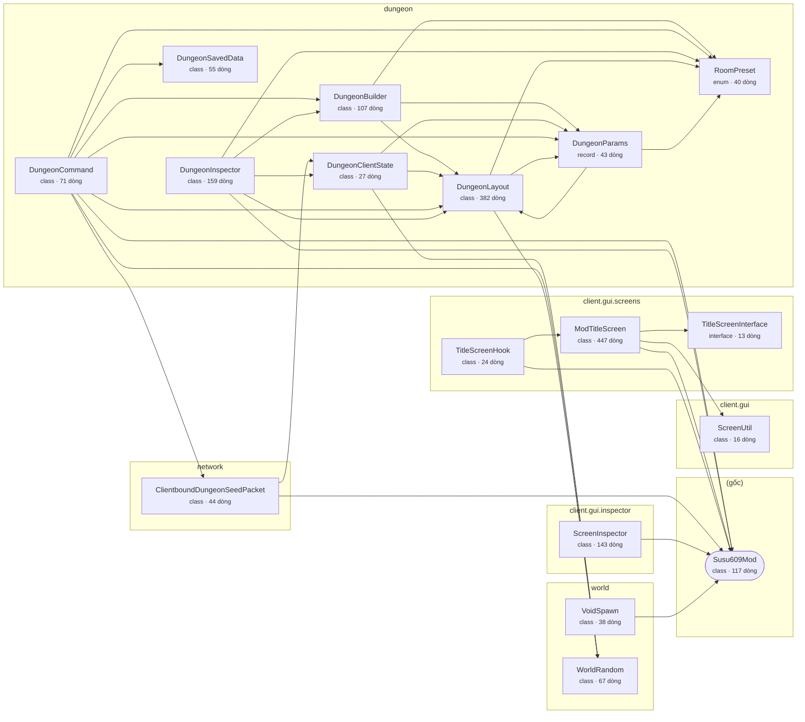

# Kiến trúc mã

> File này được sinh tự động bởi `tools/gen_architecture.py`. Đừng sửa tay.

- Package gốc: `net.susu609.the8dungeon`
- 17 class/kiểu Java, 1793 dòng, 33 phụ thuộc nội bộ

Mũi tên `A --> B` nghĩa là A có dùng tới B. Khối bo tròn là entry point `@Mod`.

## Class theo package

### (gốc)

| Class | Loại | Dòng | Dùng tới | Event Forge |
|---|---|---|---|---|
| `Susu609Mod` | class | 117 | - | NetworkEvent, NetworkEvent.Context, TickEvent, TickEvent.Phase, TickEvent.ServerTickEvent |

### client.gui

| Class | Loại | Dòng | Dùng tới | Event Forge |
|---|---|---|---|---|
| `ScreenUtil` | class | 16 | - | - |

### client.gui.inspector

| Class | Loại | Dòng | Dùng tới | Event Forge |
|---|---|---|---|---|
| `ScreenInspector` | class | 143 | Susu609Mod | ScreenEvent, ScreenEvent.KeyPressed, ScreenEvent.Render |

### client.gui.screens

| Class | Loại | Dòng | Dùng tới | Event Forge |
|---|---|---|---|---|
| `ModTitleScreen` | class | 447 | ScreenUtil, Susu609Mod, TitleScreenInterface | - |
| `TitleScreenHook` | class | 24 | ModTitleScreen, Susu609Mod | ScreenEvent, ScreenEvent.Opening |
| `TitleScreenInterface` | interface | 13 | - | - |

### dungeon

| Class | Loại | Dòng | Dùng tới | Event Forge |
|---|---|---|---|---|
| `DungeonBuilder` | class | 107 | DungeonLayout, DungeonParams, RoomPreset | - |
| `DungeonClientState` | class | 27 | DungeonLayout, DungeonParams, WorldRandom | - |
| `DungeonCommand` | class | 71 | ClientboundDungeonSeedPacket, DungeonBuilder, DungeonLayout, DungeonParams, DungeonSavedData, RoomPreset, Susu609Mod, WorldRandom | RegisterCommandsEvent |
| `DungeonInspector` | class | 159 | DungeonBuilder, DungeonClientState, DungeonLayout, RoomPreset, Susu609Mod | RegisterGuiOverlaysEvent, RenderLevelStageEvent, RenderLevelStageEvent.Stage |
| `DungeonLayout` | class | 382 | DungeonParams, RoomPreset, WorldRandom | - |
| `DungeonParams` | record | 43 | DungeonLayout, RoomPreset | - |
| `DungeonSavedData` | class | 55 | - | - |
| `RoomPreset` | enum | 40 | - | - |

### network

| Class | Loại | Dòng | Dùng tới | Event Forge |
|---|---|---|---|---|
| `ClientboundDungeonSeedPacket` | class | 44 | DungeonClientState, Susu609Mod | FMLCommonSetupEvent, NetworkEvent, NetworkEvent.Context |

### world

| Class | Loại | Dòng | Dùng tới | Event Forge |
|---|---|---|---|---|
| `VoidSpawn` | class | 38 | Susu609Mod | LevelEvent, LevelEvent.CreateSpawnPosition |
| `WorldRandom` | class | 67 | - | - |

## Tài nguyên

- `META-INF/mods.toml`
- `assets/susu609/lang/en_us.json`
- `assets/susu609/textures/gui/title/mod_title.png`
- `assets/susu609/textures/map/minimap_icons.png`
- `data/susu609/worldgen/world_preset/void.json`
- `pack.mcmeta`
- `susu609.mixins.json`
