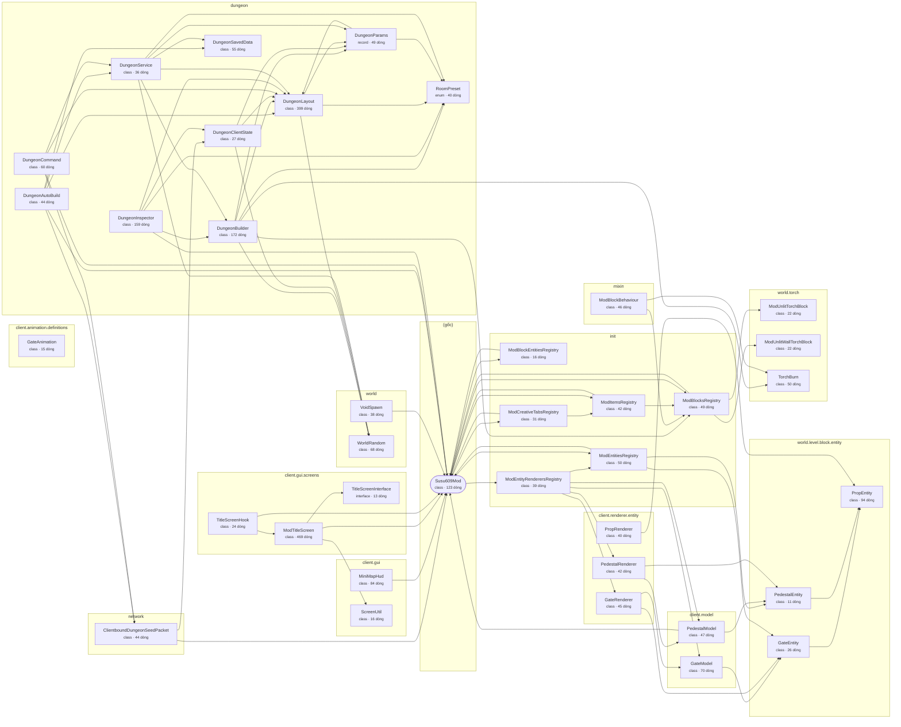

# Kiến trúc mã

> File này được sinh tự động bởi `tools/gen_architecture.py`. Đừng sửa tay.

- Package gốc: `net.susu609.the8dungeon`
- 38 class/kiểu Java, 2677 dòng, 77 phụ thuộc nội bộ

Mũi tên `A --> B` nghĩa là A có dùng tới B. Khối bo tròn là entry point `@Mod`.

## Class theo package

### (gốc)

| Class | Loại | Dòng | Dùng tới | Event Forge |
|---|---|---|---|---|
| `Susu609Mod` | class | 123 | ModBlockEntitiesRegistry, ModBlocksRegistry, ModCreativeTabsRegistry, ModEntitiesRegistry, ModEntityRenderersRegistry, ModItemsRegistry | NetworkEvent, NetworkEvent.Context, TickEvent, TickEvent.Phase, TickEvent.ServerTickEvent |

### client.animation.definitions

| Class | Loại | Dòng | Dùng tới | Event Forge |
|---|---|---|---|---|
| `GateAnimation` | class | 15 | - | - |

### client.gui

| Class | Loại | Dòng | Dùng tới | Event Forge |
|---|---|---|---|---|
| `MiniMapHud` | class | 84 | Susu609Mod | RenderGuiEvent, RenderGuiEvent.Post |
| `ScreenUtil` | class | 16 | - | - |

### client.gui.screens

| Class | Loại | Dòng | Dùng tới | Event Forge |
|---|---|---|---|---|
| `ModTitleScreen` | class | 469 | ScreenUtil, Susu609Mod, TitleScreenInterface | - |
| `TitleScreenHook` | class | 24 | ModTitleScreen, Susu609Mod | ScreenEvent, ScreenEvent.Opening |
| `TitleScreenInterface` | interface | 13 | - | - |

### client.model

| Class | Loại | Dòng | Dùng tới | Event Forge |
|---|---|---|---|---|
| `GateModel` | class | 70 | GateEntity | - |
| `PedestalModel` | class | 47 | PedestalEntity, Susu609Mod | - |

### client.renderer.entity

| Class | Loại | Dòng | Dùng tới | Event Forge |
|---|---|---|---|---|
| `GateRenderer` | class | 45 | GateEntity, GateModel | - |
| `PedestalRenderer` | class | 42 | PedestalEntity, PedestalModel | - |
| `PropRenderer` | class | 40 | PropEntity | - |

### dungeon

| Class | Loại | Dòng | Dùng tới | Event Forge |
|---|---|---|---|---|
| `DungeonAutoBuild` | class | 44 | ClientboundDungeonSeedPacket, DungeonLayout, DungeonSavedData, DungeonService, Susu609Mod | PlayerEvent, PlayerEvent.PlayerLoggedInEvent |
| `DungeonBuilder` | class | 172 | DungeonLayout, DungeonParams, ModBlocksRegistry, RoomPreset, TorchBurn, WorldRandom | - |
| `DungeonClientState` | class | 27 | DungeonLayout, DungeonParams, WorldRandom | - |
| `DungeonCommand` | class | 60 | ClientboundDungeonSeedPacket, DungeonLayout, DungeonService, Susu609Mod | RegisterCommandsEvent |
| `DungeonInspector` | class | 159 | DungeonBuilder, DungeonClientState, DungeonLayout, RoomPreset, Susu609Mod | RegisterGuiOverlaysEvent, RenderLevelStageEvent, RenderLevelStageEvent.Stage |
| `DungeonLayout` | class | 399 | DungeonParams, RoomPreset, WorldRandom | - |
| `DungeonParams` | record | 49 | DungeonLayout, RoomPreset | - |
| `DungeonSavedData` | class | 55 | - | - |
| `DungeonService` | class | 36 | DungeonBuilder, DungeonLayout, DungeonParams, DungeonSavedData, RoomPreset, WorldRandom | - |
| `RoomPreset` | enum | 40 | - | - |

### init

| Class | Loại | Dòng | Dùng tới | Event Forge |
|---|---|---|---|---|
| `ModBlockEntitiesRegistry` | class | 16 | Susu609Mod | - |
| `ModBlocksRegistry` | class | 49 | ModUnlitTorchBlock, ModUnlitWallTorchBlock, Susu609Mod | - |
| `ModCreativeTabsRegistry` | class | 31 | ModItemsRegistry, Susu609Mod | - |
| `ModEntitiesRegistry` | class | 50 | GateEntity, PedestalEntity, Susu609Mod | EntityAttributeCreationEvent |
| `ModEntityRenderersRegistry` | class | 39 | GateModel, GateRenderer, ModEntitiesRegistry, PedestalModel, PedestalRenderer | EntityRenderersEvent, EntityRenderersEvent.RegisterLayerDefinitions, EntityRenderersEvent.RegisterRenderers |
| `ModItemsRegistry` | class | 42 | ModBlocksRegistry, Susu609Mod | BuildCreativeModeTabContentsEvent |

### mixin

| Class | Loại | Dòng | Dùng tới | Event Forge |
|---|---|---|---|---|
| `ModBlockBehaviour` | class | 46 | ModBlocksRegistry, TorchBurn | - |

### network

| Class | Loại | Dòng | Dùng tới | Event Forge |
|---|---|---|---|---|
| `ClientboundDungeonSeedPacket` | class | 44 | DungeonClientState, Susu609Mod | FMLCommonSetupEvent, NetworkEvent, NetworkEvent.Context |

### world

| Class | Loại | Dòng | Dùng tới | Event Forge |
|---|---|---|---|---|
| `VoidSpawn` | class | 38 | Susu609Mod | LevelEvent, LevelEvent.CreateSpawnPosition |
| `WorldRandom` | class | 68 | - | - |

### world.level.block.entity

| Class | Loại | Dòng | Dùng tới | Event Forge |
|---|---|---|---|---|
| `GateEntity` | class | 26 | PropEntity | - |
| `PedestalEntity` | class | 11 | PropEntity | - |
| `PropEntity` | class | 94 | - | - |

### world.torch

| Class | Loại | Dòng | Dùng tới | Event Forge |
|---|---|---|---|---|
| `ModUnlitTorchBlock` | class | 22 | - | - |
| `ModUnlitWallTorchBlock` | class | 22 | - | - |
| `TorchBurn` | class | 50 | - | - |

## Tài nguyên

- `META-INF/mods.toml`
- `assets/susu609/blockstates/torch_off.json`
- `assets/susu609/blockstates/wall_torch_off.json`
- `assets/susu609/lang/en_us.json`
- `assets/susu609/lang/vi_vn.json`
- `assets/susu609/models/block/torch_off.json`
- `assets/susu609/models/block/wall_torch_off.json`
- `assets/susu609/models/item/torch.json`
- `assets/susu609/models/item/torch_off.json`
- `assets/susu609/sounds.json`
- `assets/susu609/textures/block/torch_off.png`
- `assets/susu609/textures/entity/clawd_agent.png`
- `assets/susu609/textures/gui/title/mod_title.png`
- `assets/susu609/textures/map/minimap_icons.png`
- `data/susu609/loot_tables/blocks/torch_dim.json`
- `data/susu609/loot_tables/blocks/torch_off.json`
- `data/susu609/loot_tables/blocks/wall_torch_dim.json`
- `data/susu609/loot_tables/blocks/wall_torch_off.json`
- `data/susu609/worldgen/world_preset/void.json`
- `pack.mcmeta`
- `susu609.mixins.json`
